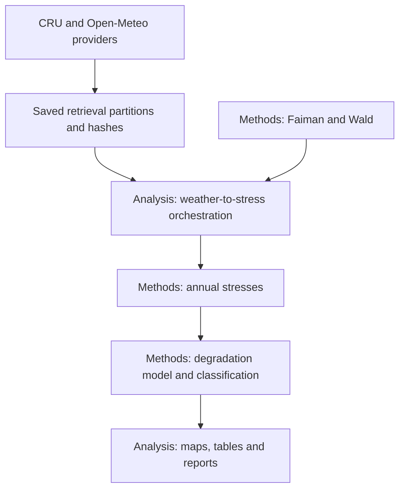

# Applied degradation map analysis

This workflow consumes weather downloaded by `energy_data_retrieval`, builds annual
climate stresses, and calls the existing `energy_methods.degradation_mapping` model.
It produces hydrolysis, photodegradation, thermomechanical and combined-rate maps,
rate classes, cell tables, provenance and an offline HTML report.

The example retrieves **real modelled weather**, not station observations: explicit
ERA5 through Open-Meteo, plus CRU TS v4.10 temperature validity for land support.
It samples 2016–2018 at 15° centres globally, excluding Antarctica. This is a bounded
screening run, not the thesis's native-resolution raster reproduction. No API key is
needed for Open-Meteo's public non-commercial endpoint. Observe provider limits;
requests are bounded, cached and restartable.

## Run from the repository root

```bash
uv sync --locked --all-packages

# Provider code from data-retrieval saves normalized, checksummed inputs.
uv run --no-sync energy-degradation-study retrieve \
  --config analysis/examples/degradation/global_2016_2018.toml \
  --data-dir data/degradation-2016-2018

# Analysis consumes only those saved inputs; this command makes no network requests.
uv run --no-sync energy-degradation-study run \
  --config analysis/examples/degradation/global_2016_2018.toml \
  --data-dir data/degradation-2016-2018 \
  --output artifacts/degradation-2016-2018
```

Use `all` with the same arguments to retrieve and analyse in sequence. Set
`--use-environment-proxy` only when public retrieval requires your `HTTPS_PROXY`;
proxy credentials are not persisted. The default is two retrieval workers and a
three-second minimum request interval. Successful weather partitions are reused;
interrupted retrieval does not create a complete retrieval manifest. The `run`
command refuses an existing output directory, verifies every input partition and
mask, and publishes outputs atomically only after reports finish.

Edit a copy of the TOML for a regional grid or another complete-year period.
Bounds specify **cell centres**, with spans divisible by `step_degrees`; steps must
be 0.25–30° and a study cannot exceed 10,000 grid cells. Use separate data/output
folders per configuration. Small regional grids are advisable before larger runs.
Fine global hourly downloads need a different access/batching strategy; this CLI
is not a bulk ERA5 mirror. The CRU mask covers supported land cells, not Antarctica.

## Separation of responsibilities



Retrieval adds two opt-in Open-Meteo fields: ambient RH and calculated
extraterrestrial horizontal irradiance (TOA). This leaves the existing weather
client's default columns intact. RH, ambient temperature and wind use arithmetic
means of instantaneous start/end samples; GHI and TOA use the preceding-hour mean
labelled at interval end. Saved records are hourly **UTC interval starts**. The
request includes the extra endpoint day and explicitly disables elevation
downscaling and model blending. Requested centres and returned ERA5 grid-cell
coordinates are both retained; TOA is calculated by Open-Meteo, not a separate
retrieved ERA5 TOA field.

The reusable `energy_methods.degradation_weather` module implements the 2019
mapping paper's GHI-based Faiman model (Eq. 10) and Wald UV regressions (Eqs. 5–8).
Wind at 10 m is scaled to 2 m with exponent 0.2. The open-rack crystalline-silicon
heat-loss coefficients are u₀=26.9 W m⁻² K⁻¹ and u₁=6.2 W s m⁻³ K⁻¹. Using GHI is
an explicit horizontal-irradiance approximation. UV covers 280–400 nm; UV index
and ERA5 UV to 440 nm are not interchangeable inputs. Clearness index is clipped
to [0.1, 0.7]; zero GHI with finite TOA gives zero UV. Positive GHI with zero TOA
remains unavailable and is counted. Negative provider TOA is marked unavailable
for processing and counted separately, while raw values remain in saved inputs.
It is not clipped to zero. Missing observations are never filled.

## Calibration and aggregation

The companion JSON contains the nine mono-Si coefficients from Kaaya et al.
(2019), Table IV, checked against the author's 2020 thesis Table 4.3, p.45:

| Mechanism | Prefactor | Activation energy (eV) | Exponents |
|---|---:|---:|---|
| Hydrolysis | 4.91 × 10⁷ | 0.74 | n = 1.90 |
| Photodegradation | 71.83 | 0.45 | n = 1.90, x = 0.63 |
| Thermomechanical | 2.04 | 0.43 | θ = 2.24 |

**A_N=1 is a declared scenario assumption.** No coefficients are fitted during
this run. A parameter file is mandatory and its hash and provenance are retained.
These coefficients describe a particular mono-Si module, not every PV technology.

For each complete UTC calendar year, the methods package computes:

- Arithmetic annual mean module temperature and **ambient RH in percent**.
- Mean of daily maximum and daily minimum module temperatures.
- Integrated annual UV dose in kWh m⁻² year⁻¹.
- One thermal cycle per day by explicit configuration: 365 or 366 per year.

A single missing hourly stress masks that cell-year. `mean_stress` (the example)
applies the degradation model once to the average of annual stresses;
`mean_rate` averages rates calculated separately for each year. They are nonlinear
and generally differ. Both require complete support for every selected year.
Arithmetic ambient RH, averaged daily extrema, cycle counting and A_N are explicit
implementation/scenario choices; they do not establish equivalence to the original
authors' effective-stress calibration. See [method equations and limitations](../../../../docs/degradation.md).

## Outputs

| File | Contents |
|---|---|
| `annual_stresses.nc` | Six annual stress fields, valid-hour and inconsistent-solar-hour counts |
| `degradation.nc` | Four rates (% year⁻¹), rate classes, land support and model metadata |
| `map_cells.csv` | All grid centres, including nodata/ocean cells |
| `source_cells.csv` | Requested centres and selected native ERA5 cells |
| `*_rate.geojson`, `rate_class.geojson` | Valid sample-centred polygon footprints |
| `parameters.json`, `manifest.json` | Calibration, input hashes, versions, output hashes and citations |
| `reports/` | Standalone HTML plus PNG/SVG mechanism and class maps |

Statistics weight **whole coarse cell footprints**, including coastal ocean fractions;
they are not global land-area estimates. Outlines come from CRU's fine validity mask.
The maps do not interpolate between samples or imply native ERA5 resolution.
Generated datasets and reports stay outside Git. The HTML embeds figures and needs
no CDN; links to NetCDF/CSV/SVG work when the output folder is kept together.

## Attribution and verification

Julián Ascencio Vásquez's 2021 thesis is the primary scientific reference. Individual
sources include Ascencio-Vásquez et al. (2019) for mapping, Kaaya et al. (2019) and
Kaaya (2020) for calibration, Faiman (2008), Huld and Gracia Amillo (2015), and Wald
(2018) for weather transformations. Metadata, DOIs and implementation roles are in
[the shared reference catalogue](../../../../docs/references.md), also included
in each generated manifest and report.

Credit Copernicus ERA5, Open-Meteo (CC BY 4.0), and CRU TS, Climatic Research Unit,
University of East Anglia (ODbL / Database Contents License). Redistributing the
CRU-derived land mask requires retaining attribution and applicable database terms.
The Open-Meteo public endpoint is limited to non-commercial use.

Tests use clearly labelled synthetic provider responses, independent numerical
calculations, leap-year integration, missing-hour masking, restart behaviour,
checksum failures, offline analysis, atomic publication and report generation.
They make no live network requests and do not claim field validation.
